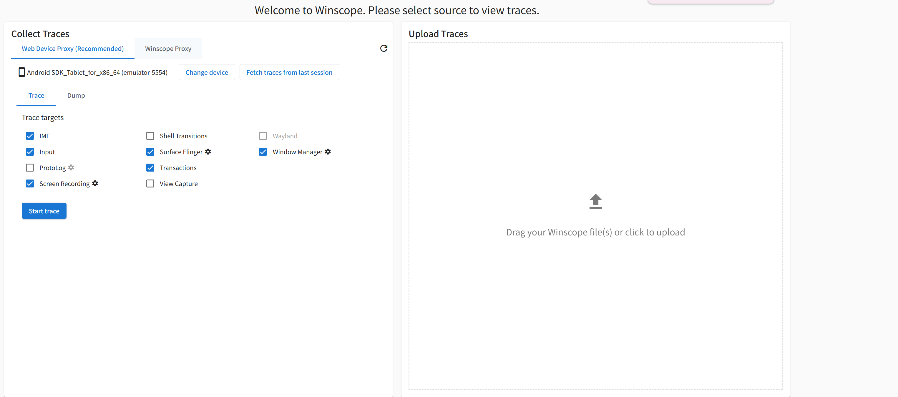
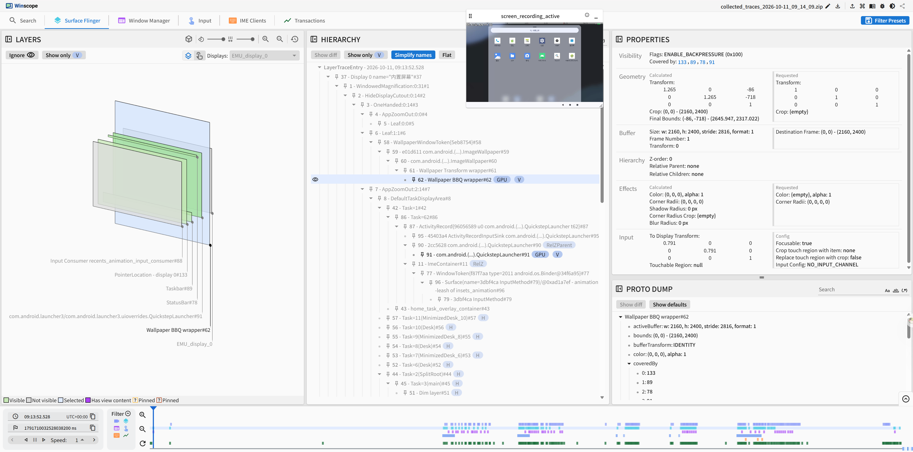

# winscope-build

[简体中文](README.md) | **English**

Build AOSP's [Winscope](https://android.googlesource.com/platform/development/+/refs/heads/main/tools/winscope/) (the trace viewer for WindowManager, SurfaceFlinger, Transitions, ProtoLog, IME, ViewCapture and more) with GitHub Actions, without a `repo sync` of the whole AOSP tree.

## Source repositories

Winscope refers to other repositories by relative paths in the AOSP tree layout. `scripts/fetch_sources.sh` sparse-checks out only the parts it needs and places them in the same layout:

| Path | Repository | Used for |
|---|---|---|
| `development/tools/winscope` | `platform/development` | Winscope source |
| `frameworks/base/core/proto`, `libs/WindowManager/Shell/proto` | `platform/frameworks/base` | WindowManager, IME and Shell transition trace protos and their imports |
| `frameworks/libs/systemui/viewcapturelib/.../proto` | `platform/frameworks/libs/systemui` | ViewCapture proto |
| `frameworks/proto_logging/stats/enums` | `platform/frameworks/proto_logging` | Enums imported by the view protos |
| `external/perfetto` (full) | `platform/external/perfetto` | SurfaceFlinger, transactions, ProtoLog, input and transition protos, plus the trace processor (wasm) and the TS protos it generates |

The `frameworks/*` repositories are only needed up to Android 16; from Android 17 on, Winscope takes all trace protos from `external/perfetto`, and the script detects this automatically. `google/protobuf/descriptor.proto` ships with protobufjs. All repositories must use the same branch or tag (`AOSP_REF`), or the protos may not match.

## Building

- **GitHub Actions**: the branch name is the AOSP tag to build, e.g. `android-16.0.0_r4` or `android-17.0.0_r1`. Pushing to that branch, or running the workflow on it, builds that tag. `main` builds `android17-release` by default, and you can enter any branch or tag in Run workflow. The output is in the run's Artifacts, with `SOURCES.txt` listing each repository's commit. A successful build on an `android-*` branch also creates or updates the [Release](https://github.com/cschengliang/winscope-build/releases) `winscope-<branch>` with a ready-to-run zip.
- **Locally (Linux / WSL)**:
  ```bash
  scripts/fetch_sources.sh android17-release ./aosp
  scripts/build_winscope.sh ./aosp
  # Output: aosp/development/tools/winscope/dist/prod
  ```
  Requires git, Node 22 and Python 3. The trace processor build uses Perfetto's `tools/install-build-deps --ui` to download emsdk, gn, ninja and other tools.

## Running

The output is a static website. Double-clicking `index.html` won't work (browsers don't load wasm from `file://`), so serve it locally first:

- **Windows**: unzip the zip from [Releases](https://github.com/cschengliang/winscope-build/releases) and double-click `run_winscope.bat` (needs Python 3). It serves Winscope on port 8080 and opens it in your browser (another port: `run_winscope.bat 9000`).
- **Other systems**: run `python3 -m http.server 8080` in the unzipped folder, then open http://localhost:8080 .

## Tutorial: capture traces through Web Device Proxy

Web Device Proxy (WDP) is a small local program from Google. The Winscope page talks to it at `ws://localhost:9167`, and it uses adb on your computer to reach the device. It's the connection method Winscope recommends.

1. **Prepare the device**: enable USB debugging and connect the phone (or start an emulator), and make sure `adb devices` lists it as `device`.
2. **Install WDP**: download it from the [Android Web Device Proxy page](https://tools.google.com/dlpage/android_web_device_proxy), install it and keep it running.
3. **Open Winscope**: open the local page above in Chrome or Edge and choose the **Web Device Proxy (Recommended)** tab under **Collect Traces**. If it says "Web Device Proxy doesn't seem to be running", make sure WDP is running and click **Retry**.
4. **Authorize**: on first connection WDP opens a popup asking to allow the current address (`http://127.0.0.1:8080`), and the device may need its own approval. Allow popups in the browser, approve in the popup, then click **Retry**. A different port or address needs approval again.
5. **Pick a device**: once connected, the device name is shown (e.g. `Android SDK_Tablet_for_x86_64 (emulator-5554)`). With several devices, use **Change device**.
6. **Capture**: on the **Trace** tab, tick the targets you want (IME, Input, Surface Flinger, Transactions, Window Manager, Screen Recording and others; those with a gear icon have settings), click **Start trace**, reproduce the issue on the device, then click **End trace**. Winscope pulls the traces back and opens them. For a single moment's state, use **Dump state** on the **Dump** tab.
7. **Later**: **Fetch traces from last session** pulls the previous capture again, and you can drag existing trace files, zips or bugreports onto **Upload Traces** on the right.



After capturing you land in the viewer. The top bar switches between Surface Flinger, Window Manager, Input, IME, Transactions and other views. On the left is a 3D view of the layers, in the middle the hierarchy tree, and on the right the selected layer's properties and raw proto dump. The timeline at the bottom steps through frames and stays in sync with the screen recording.



> The other tab, **Winscope Proxy**, is the older method: run `python winscope_proxy.py` from the build (`run_winscope.bat` starts it in its own window when adb is found; it listens on port 5544), then paste the token it prints into the page. You can ignore it when using WDP.
