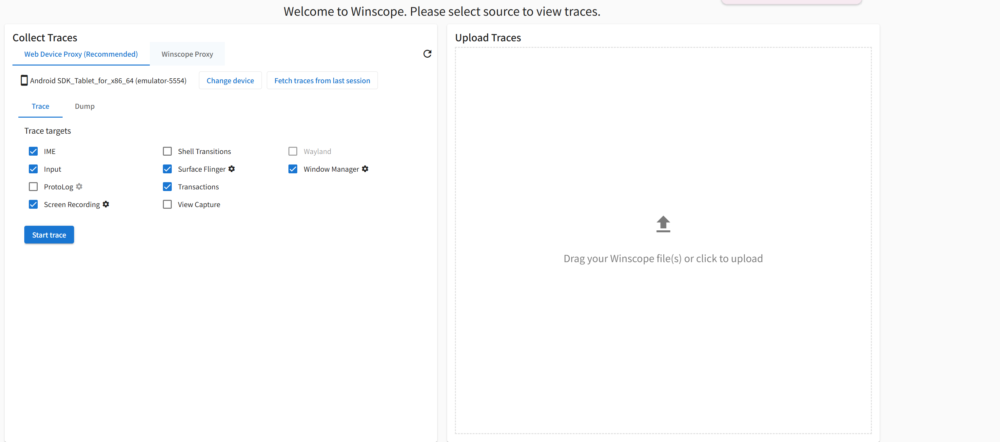
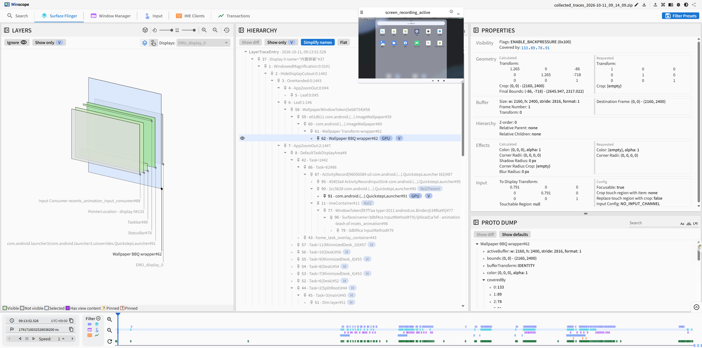

# winscope-build

[简体中文](README.md) | **English**

Ready-to-run prebuilt packages and lightweight build scripts for AOSP's [Winscope](https://android.googlesource.com/platform/development/+/refs/heads/main/tools/winscope/)—the trace viewer for Android's **SurfaceFlinger, WindowManager, Transactions, Transitions, ProtoLog, Input, IME, ViewCapture**, and more.

Building an up-to-date Winscope normally requires a full `repo sync` of AOSP plus compiling Perfetto's Trace Processor (WASM). This repository sparse-checks out only the required pieces, builds them cleanly in GitHub Actions, and publishes ready-to-run bundles.

- **Just want to use Winscope?** Jump to [Quick Start](#quick-start) and [User Guide](#user-guide)—no build required.
- **Need a different Android version?** See [Building Yourself](#building-yourself) for GitHub Actions or local Linux / WSL builds.

---

## Quick Start

### 1. Download a prebuilt bundle

Go to [Releases](https://github.com/cschengliang/winscope-build/releases), download the zip for your target Android version (e.g. `winscope-android-16.0.0_r4.zip` or `winscope-android-17.0.0_r1.zip`), and unzip it.

### 2. Start a local web server

Winscope is a static web app that loads WebAssembly (`.wasm`). Browsers block `.wasm` requests over `file://`, so double-clicking `index.html` won't work. Serve it locally instead (requires **Python 3**):

- **Windows**: Double-click `run_winscope.bat` in the unzipped folder. It starts a local server on port `8080` and opens Winscope in your browser (use another port via `run_winscope.bat 9000`).
- **macOS / Linux**: Run inside the unzipped folder:
  ```bash
  python3 -m http.server 8080 --bind 127.0.0.1
  ```
  Then open <http://127.0.0.1:8080> in Chrome or Edge.

> [!NOTE]
> Keep the terminal window open while using Winscope; closing it stops the local server.

---

## User Guide

The Winscope landing page has two panels: **Upload Traces** on the right for existing files, and **Collect Traces** on the left for live capture from a device.

### Option 1: Open existing traces or bugreports

If you already have trace files, a `.zip`, or an Android `bugreport`, drag and drop them onto **Upload Traces** on the right (or click to browse). No device connection or extra tools needed.

### Option 2: Capture live traces from a device (Web Device Proxy, recommended)

Winscope recommends Google's **Web Device Proxy (WDP)**—a small local helper (listening on `ws://localhost:9167`) that bridges the Winscope web page to your local `adb`.

1. **Connect your device**  
   Enable USB debugging on your phone and connect it (or start an Android emulator). Verify `adb devices` lists it with status `device`.

2. **Install and run WDP**  
   Download it from the [Android Web Device Proxy page](https://tools.google.com/dlpage/android_web_device_proxy), install it, and keep it running in the background.

3. **Open Winscope and authorize once**  
   - Open the local Winscope page in Chrome or Edge and stay on the **Web Device Proxy (Recommended)** tab under **Collect Traces**.
   - If it says `Web Device Proxy doesn't seem to be running`, make sure WDP is running and click **Retry**.
   - On **first connection**, WDP opens a browser popup asking to allow the current origin (e.g. `http://127.0.0.1:8080`), and the device may prompt for approval too. Allow popups in the browser, approve the prompt, then click **Retry**.

4. **Select a device and trace targets**  
   - Once connected, the device name appears (e.g. `Android SDK_Tablet_for_x86_64 (emulator-5554)`). Click **Change device** if multiple devices are attached.
   - On the **Trace** tab, tick the targets you want (IME, Input, Surface Flinger, Transactions, Window Manager, Screen Recording, etc.; items with a gear icon have extra settings).

5. **Capture**  
   - Click **Start trace**, reproduce the issue on the device, then click **End trace**. Winscope automatically pulls the traces and opens the viewer.
   - **Capture a single snapshot**: Switch to the **Dump** tab and click **Dump state**.
   - **Re-open the last capture**: Click **Fetch traces from last session** without recording again.



<details>
<summary>Alternative: Legacy Winscope Proxy (without installing WDP)</summary>

If you prefer not to install WDP, switch to the **Winscope Proxy** tab on the left:

- **Windows**: When `adb` is on your `PATH`, `run_winscope.bat` automatically launches `winscope_proxy.py` (port `5544`) in a separate window.
- **macOS / Linux**: Run `python3 winscope_proxy.py` inside the unzipped folder.

Copy the **token** printed in the terminal and paste it into the Winscope page. You can ignore or close this window when using WDP.

</details>

### Navigating the viewer

After capturing or uploading traces, you land in the viewer:

- **Top bar**: Switch between Surface Flinger, Window Manager, Input, IME Clients, Transactions, and other views.
- **Left (`LAYERS`)**: Interactive 3D layer view for inspecting bounds, z-order, and occlusion.
- **Middle (`HIERARCHY`)**: Full window / layer hierarchy tree with filtering and search.
- **Right (`PROPERTIES` / `PROTO DUMP`)**: Computed/requested properties and raw proto dump for the selected item.
- **Bottom timeline & screen recording**: Step through frames in sync with the recorded video.



---

## FAQ

**Q: Double-clicking `index.html` shows a blank page or errors?**  
A: Browsers disallow loading WebAssembly (`trace_processor.wasm`) from `file://`. Serve the folder over HTTP as shown in [Quick Start](#quick-start).

**Q: WDP is running, but Winscope still can't connect (or broke after changing ports)?**  
A: Check whether your browser blocked WDP's authorization popup. Also, WDP grants permission per origin (host + port), so changing the port or switching between `localhost` and `127.0.0.1` requires re-authorizing.

**Q: Which Release version should I pick?**  
A: Pick the build matching (or newer than) your target device's Android version so trace protos match cleanly.

**Q: `run_winscope.bat` says Python is not found on Windows?**  
A: The script uses Python 3 to run a lightweight local server (trying `py -3`, then `python`). Install Python 3 with `PATH` enabled and try again.

---

## Building Yourself

If you need an AOSP branch or tag that isn't in Releases, build it either in GitHub Actions or locally.

### Option 1: GitHub Actions (recommended, no local setup)

Fork this repository and run builds directly in GitHub Actions:

- **One-off build (Artifact)**  
  Go to **Actions → Build Winscope → Run workflow**, and enter any AOSP branch or tag in `aosp_ref` (e.g. `android17-release` or `android-16.0.0_r4`; leaving it blank builds `android17-release` on `main`). Download the build from the run's **Artifacts** (includes `SOURCES.txt` with exact commits).
- **Automatic Release publishing**  
  Create and push a branch named after an AOSP tag starting with `android-` (e.g. `android-16.0.0_r4`, `android-17.0.0_r1`), then trigger **Run workflow** on that branch (or push build-script changes). A successful build automatically creates or updates Release `winscope-<branch>` with a ready-to-run zip.

### Option 2: Local build (Linux / WSL)

**Requirements**: `git`, **Node.js 22**, **Python 3**.

```bash
# 1. Sparse-checkout only the required AOSP sources
scripts/fetch_sources.sh android17-release ./aosp

# 2. Build the Trace Processor (WASM) and Winscope app
scripts/build_winscope.sh ./aosp

# 3. Serve the built output locally
python3 -m http.server 8080 --bind 127.0.0.1 --directory ./aosp/development/tools/winscope/dist/prod
```

The first build takes longer because it downloads Perfetto's build toolchain (`emsdk`, `gn`, `ninja`, etc.).

You can override upstream URLs via environment variables if needed:

| Environment variable | Default | Purpose |
|---|---|---|
| `AOSP_MIRROR` | `https://android.googlesource.com` | Custom AOSP mirror URL (used by `fetch_sources.sh`) |
| `NPM_REGISTRY` | `https://registry.npmjs.org/` | Custom npm registry URL (used by `build_winscope.sh`) |

---

## How It Works

Winscope references `.proto` definitions and Perfetto's Trace Processor using AOSP-relative paths. This repo avoids a full AOSP checkout in three steps:

1. **Minimal sparse checkout (`scripts/fetch_sources.sh`)**  
   Uses `git sparse-checkout` and shallow blobless clones (`--depth 1 --filter=blob:none`) to pull only the required directories into an AOSP-like layout, recording exact commit SHAs in `SOURCES.txt`:

   | Local path | AOSP repository | Used for | Versions |
   |---|---|---|---|
   | `development/tools/winscope` | `platform/development` | Winscope source | All |
   | `external/perfetto` (full) | `platform/external/perfetto` | SurfaceFlinger / Transactions / ProtoLog / Input / Transitions protos, plus the Trace Processor (WASM) and generated TS protos | All |
   | `frameworks/base/core/proto`<br>`frameworks/base/libs/WindowManager/Shell/proto` | `platform/frameworks/base` | WindowManager / IME / Shell transition protos and imports | ≤ Android 16 |
   | `frameworks/libs/systemui/viewcapturelib/.../proto` | `platform/frameworks/libs/systemui` | ViewCapture proto | ≤ Android 16 |
   | `frameworks/proto_logging/stats/enums` | `platform/frameworks/proto_logging` | Enums imported by view protos | ≤ Android 16 |

   > From Android 17 onward, Winscope reads all trace protos from `external/perfetto`; the script checks `protos/build.js` to skip `frameworks/*` automatically. `google/protobuf/descriptor.proto` ships with `protobufjs`. Every repo uses the same `AOSP_REF` so proto versions stay aligned.

2. **External build fixes (`scripts/build_winscope.sh`)**  
   - Some AOSP release branches pin `package-lock.json` to Google's internal Artifact Registry (which returns 404 externally); the script temporarily rewrites those URLs to the public npm registry and restores `package-lock.json` on exit.
   - Automatically handles both legacy Winscope (`npm run build:prod`) and modern Winscope (Perfetto WASM + `build:protos` + `build:app`).

3. **Skip Perfetto's test data (`scripts/install_perfetto_deps.py`)**  
   Perfetto's `tools/install-build-deps --ui` normally syncs a large `//test/data` set. This wrapper runs the installer while skipping the test-data sync, saving significant download time and disk space.
