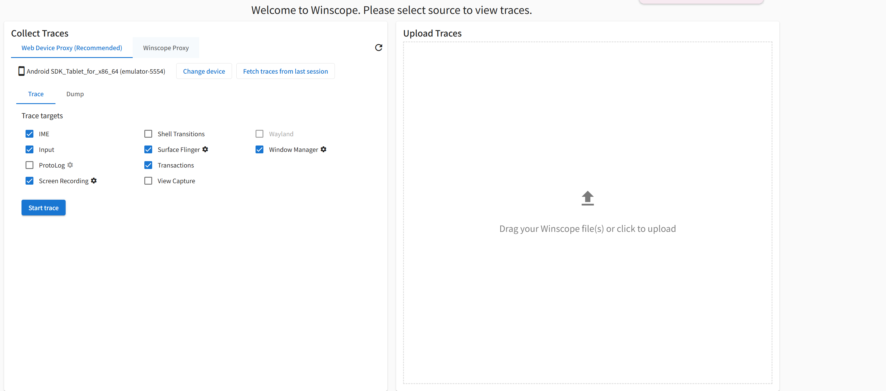
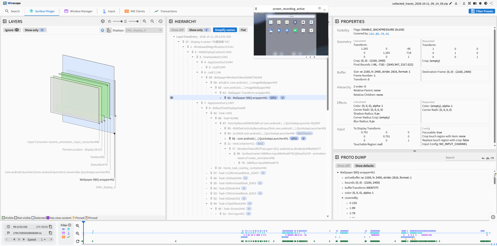

# winscope-build

**简体中文** | [English](README.en.md)

开箱即用的 AOSP [Winscope](https://android.googlesource.com/platform/development/+/refs/heads/main/tools/winscope/) 预编译包与轻量构建脚本，用于可视化分析 Android 的 **SurfaceFlinger、WindowManager、Transactions、Transitions、ProtoLog、Input、IME、ViewCapture** 等系统 trace。

通常想用上最新版本的 Winscope，需要 `repo sync` 整个 AOSP 并编译 Perfetto Trace Processor（WASM），环境搭建成本很高。这个仓库只稀疏拉取构建所需的极少代码，通过 GitHub Actions 自动编译并发布可直接运行的安装包。

- **只想直接用？** 看 [快速上手](#快速上手) 和 [使用指南](#使用指南)，下载解压即可运行，无需编译。
- **想编其他 Android 版本？** 看 [自行构建](#自行构建)，支持 GitHub Actions 一键构建或本地 Linux / WSL 构建。

---

## 快速上手

### 1. 下载预编译包

前往 [Releases](https://github.com/cschengliang/winscope-build/releases) 页面，下载对应 Android 版本的压缩包（例如 `winscope-android-16.0.0_r4.zip`、`winscope-android-17.0.0_r1.zip`）并解压。

### 2. 启动本地服务

Winscope 是包含 WebAssembly（`.wasm`）的静态网页，浏览器出于安全限制不允许直接双击 `index.html` 打开，需要先起一个本地 HTTP 服务（需要 **Python 3**）：

- **Windows**：直接双击解压目录里的 `run_winscope.bat`。它会在 `8080` 端口启动本地服务并自动用浏览器打开 Winscope（换端口可在命令行执行 `run_winscope.bat 9000`）。
- **macOS / Linux**：在解压目录中运行：
  ```bash
  python3 -m http.server 8080 --bind 127.0.0.1
  ```
  然后用 Chrome 或 Edge 打开 <http://127.0.0.1:8080> 。

> [!NOTE]
> 使用期间请保持终端窗口不要关闭；关闭窗口即停止本地服务。

---

## 使用指南

打开 Winscope 后，首页分为左右两栏：右侧用于**导入已有文件**，左侧用于**连接设备实时抓取**。

### 方式一：查看已有的 Trace 或 Bugreport

如果手头已经有 trace 文件、压缩包或 Android `bugreport`，直接把文件拖进右侧的 **Upload Traces** 区域（或点击上传）即可立即解析查看，不需要连接设备或安装任何额外工具。

### 方式二：连接设备实时抓 Trace（推荐 Web Device Proxy）

Winscope 推荐通过 Google 官方工具 **Web Device Proxy（WDP）** 连接设备——它运行在本机后台（默认监听 `ws://localhost:9167`），负责在网页和电脑上的 `adb` 之间转发通信。

1. **连接设备**  
   打开手机的 USB 调试并连上电脑（或启动 Android 模拟器），运行 `adb devices` 确认设备状态为 `device`。

2. **安装并启动 WDP**  
   从 [Android Web Device Proxy 下载页](https://tools.google.com/dlpage/android_web_device_proxy) 下载安装，并保持它在后台运行。

3. **打开网页并完成首次授权**  
   - 用 Chrome 或 Edge 打开 Winscope，左侧 **Collect Traces** 保持在 **Web Device Proxy (Recommended)** 标签页。
   - 如果提示 `Web Device Proxy doesn't seem to be running`，确认 WDP 已启动后点 **Retry**。
   - **首次连接**时，WDP 会弹窗请求允许当前网址（如 `http://127.0.0.1:8080`）访问，手机端也可能弹出授权提示。请允许浏览器弹窗并点批准，完成后再点一次 **Retry**。

4. **选择设备与录制目标**  
   - 连上后会显示当前设备名（例如 `Android SDK_Tablet_for_x86_64 (emulator-5554)`）；连接多台设备时可点 **Change device** 切换。
   - 在 **Trace** 标签页勾选要抓的目标（IME、Input、Surface Flinger、Transactions、Window Manager、Screen Recording 等；带齿轮图标的项目可点击调整配置）。

5. **开始抓取**  
   - 点击 **Start trace**，在设备上复现问题后点 **End trace**，Winscope 会自动把 trace 拉回来并打开分析界面。
   - **只看某一时刻的状态**：切到 **Dump** 标签页，点 **Dump state**。
   - **重看上次抓的数据**：直接点 **Fetch traces from last session**，无需重新录制。



<details>
<summary>备选方式：使用旧版 Winscope Proxy（不想装 WDP 时）</summary>

如果不想安装 WDP，也可以切到左侧的 **Winscope Proxy** 标签页：

- **Windows**：如果系统 `PATH` 里有 `adb`，双击 `run_winscope.bat` 时会自动另开窗口运行 `winscope_proxy.py`（监听 `5544` 端口）。
- **macOS / Linux**：在解压目录里手动运行 `python3 winscope_proxy.py`。

启动后把终端里打印的 **token** 复制粘贴到网页即可连接。使用 WDP 时忽略或关掉该窗口即可。

</details>

### 查看分析界面

抓取完成或上传文件后，会进入主分析界面：

- **顶部标签栏**：在 Surface Flinger、Window Manager、Input、IME Clients、Transactions 等视图之间切换。
- **左侧（LAYERS）**：图层 3D 透视图，直观查看遮挡、位置和层级关系。
- **中间（HIERARCHY）**：完整的窗口 / 图层层级树，支持过滤与搜索。
- **右侧（PROPERTIES / PROTO DUMP）**：选中节点的详细属性与原始 Proto 数据。
- **底部时间轴 & 录屏窗口**：支持逐帧拖动回放，并与屏幕录像同步联动。



---

## 常见问题

**Q：直接双击 `index.html` 打开后页面白屏或报错？**  
A：浏览器禁止在 `file://` 协议下加载 WebAssembly（`trace_processor.wasm`）。请按 [快速上手](#快速上手) 的方式通过本地 HTTP 服务打开。

**Q：WDP 已经启动了，网页还是连不上，或换了端口后连接失败？**  
A：先检查浏览器地址栏是否拦截了 WDP 的授权弹窗；另外，WDP 的授权按“地址 + 端口”分别生效，换端口或混用 `localhost` 与 `127.0.0.1` 都需要重新授权。

**Q：Releases 里有多个 Android 版本，应该选哪一个？**  
A：建议优先选择与目标设备 Android 版本一致（或更新）的构建包，避免因版本差异导致部分 proto 字段解析不完整。

**Q：Windows 双击 `run_winscope.bat` 提示找不到 Python？**  
A：脚本依赖本机 Python 3 来启动轻量静态服务器（优先调用 `py -3`，其次 `python`）。安装 Python 3 并确保加入 `PATH` 后重试即可。

---

## 自行构建

如果需要编译 Releases 里没有的 AOSP 分支或 tag，可以选择以下任意一种方式。

### 方式一：GitHub Actions（推荐，无需本地环境）

Fork 本仓库后，直接利用 GitHub Actions 在云端构建：

- **临时构建任意版本（产出 Artifact）**  
  进入仓库的 **Actions → Build Winscope → Run workflow**，在 `aosp_ref` 填入要编的 AOSP 分支或 tag（如 `android17-release`、`android-16.0.0_r4`；留空时 `main` 分支默认编译 `android17-release`）。构建完成后在运行页面的 **Artifacts** 中下载，内含记录各仓库 commit 的 `SOURCES.txt`。
- **自动发布到 Releases**  
  新建并推送一个以 `android-` 开头、与目标 AOSP tag 同名的分支（例如 `android-16.0.0_r4`、`android-17.0.0_r1`），在该分支上执行 **Run workflow**（或推送构建脚本变更）。编译成功后会自动创建或更新名为 `winscope-<分支名>` 的 Release，并附上可直接解压运行的 zip 包。

### 方式二：本地构建（Linux / WSL）

**环境要求**：`git`、**Node.js 22**、**Python 3**。

```bash
# 1. 稀疏拉取所需 AOSP 源码
scripts/fetch_sources.sh android17-release ./aosp

# 2. 编译 Trace Processor (WASM) 与 Winscope 前端
scripts/build_winscope.sh ./aosp

# 3. 启动本地服务预览构建产物
python3 -m http.server 8080 --bind 127.0.0.1 --directory ./aosp/development/tools/winscope/dist/prod
```

首次编译时，脚本会自动下载 Perfetto 构建工具链（`emsdk`、`gn`、`ninja` 等），耗时相对较长。

如果访问默认源较慢，可以通过环境变量指定镜像：

| 环境变量 | 默认值 | 说明 |
|---|---|---|
| `AOSP_MIRROR` | `https://android.googlesource.com` | 替换为可访问的 AOSP 镜像地址（用于 `fetch_sources.sh`） |
| `NPM_REGISTRY` | `https://registry.npmjs.org/` | 自定义 npm 镜像源（用于 `build_winscope.sh`） |

---

## 实现原理

Winscope 在构建时会按 AOSP 的相对目录结构引用其他仓库的 `.proto` 和 Perfetto 的 Trace Processor。本仓库主要做了三件事来摆脱完整 AOSP 依赖：

1. **按需稀疏拉取（`scripts/fetch_sources.sh`）**  
   使用 `git sparse-checkout` 与浅克隆（`--depth 1 --filter=blob:none`）只拉取构建必需的目录，并按原 AOSP 结构摆放，同时把各仓库的精确 commit 记录到 `SOURCES.txt`：

   | 本地路径 | AOSP 仓库 | 用途 | 适用版本 |
   |---|---|---|---|
   | `development/tools/winscope` | `platform/development` | Winscope 源码 | 全部 |
   | `external/perfetto`（完整） | `platform/external/perfetto` | SurfaceFlinger / Transactions / ProtoLog / Input / Transitions proto，以及 Trace Processor (WASM) 与生成的 TS proto | 全部 |
   | `frameworks/base/core/proto`<br>`frameworks/base/libs/WindowManager/Shell/proto` | `platform/frameworks/base` | WindowManager / IME / Shell transition proto 及其 import | ≤ Android 16 |
   | `frameworks/libs/systemui/viewcapturelib/.../proto` | `platform/frameworks/libs/systemui` | ViewCapture proto | ≤ Android 16 |
   | `frameworks/proto_logging/stats/enums` | `platform/frameworks/proto_logging` | view 相关 proto 引用的枚举 | ≤ Android 16 |

   > 从 Android 17 起，Winscope 的 trace proto 已全部收敛到 `external/perfetto`，脚本会自动检查 `protos/build.js` 判断是否需要拉取 `frameworks/*`。`google/protobuf/descriptor.proto` 由 `protobufjs` 自带。所有仓库均使用同一 `AOSP_REF`，避免 proto 版本不匹配。

2. **屏蔽外部环境构建坑（`scripts/build_winscope.sh`）**  
   - 部分 AOSP 发布分支的 `package-lock.json` 锁定了 Google 内部 npm 源（外部环境会 404），脚本会在安装依赖时自动临时替换为公共 npm 源，并在退出时还原。
   - 自动兼容旧版 Winscope（`npm run build:prod`）与新版 Winscope（Perfetto WASM + `build:protos` + `build:app`）。

3. **跳过庞大的测试数据（`scripts/install_perfetto_deps.py`）**  
   Perfetto 的 `tools/install-build-deps --ui` 默认会同步大量 `//test/data` 测试集；脚本封装了该安装器并跳过测试数据同步，大幅减少 CI 与本地的下载耗时和磁盘占用。
